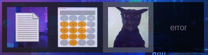

# Quickstart UI
Quickstart is a quick accessibility app that can speed up app launching and other things. It works with many different things like apps, folders, files etc.

## Installation
Download the exe from [releases](https://github.com/GamerReaper09/Quickstart-UI/releases/tag/1.0). When running you need a config.json file in the same directory as the exe that is configured based on what apps and files you want.
This config can be made either with the configbuilder or by yourself. 

## About the project
This project is built in Python and uses tkinter for most of the UI. The goal of it is to be a simple and easy to use app that can be used by anyone.

## Self-Building
If you want to build the app yourself, you can do so by downloading the quickstart.py and configbuilder.py files.
The only dependency that needs installing is keyboard which can be installed with pip.

